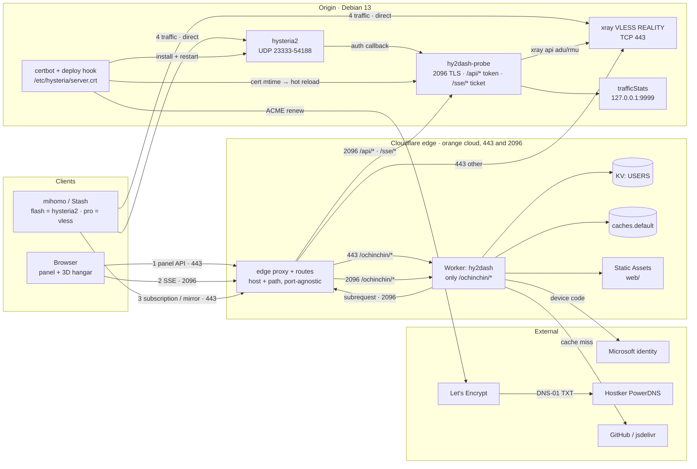
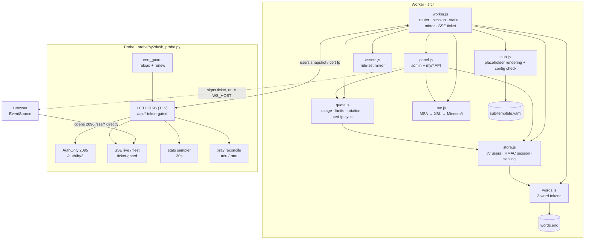

# hy2dash

Subscription panel as a **Cloudflare Worker**. The `main` branch is fully serverless now;
the former Go monolith is preserved untouched on the `archive/steam-host` branch.
Its traffic collector was **split out into a standalone origin backend** in `probe/`
(plain-stdlib Python + systemd, running on the Hysteria 2 origin; see `probe/README.md`).
The main branch therefore has four parts: edge Worker, static assets, subscription template
and the origin collector; the two sides share only a set of `/api/*` JSON contracts.

The UI and the 3D skyport (every file under `web/` except `login.html`) are byte-for-byte
unchanged. There is no build step and no Node toolchain requirement — assets are served
directly by Workers Static Assets.

## Login: Microsoft device code -> genuine Minecraft identity

1. Request a Microsoft device code (consumer tenant, public client, no client_secret).
2. The user enters the code on the verification page; the Worker polls for the MSA token.
3. MSA token -> Xbox Live user token -> XSTS token.
4. XSTS -> Minecraft `login_with_xbox` -> Minecraft access token.
5. `/minecraft/profile` yields the Minecraft UUID (dashless hex) and the game name, used as the identity key.

The Microsoft client_id is hardcoded as `MS_CLIENT_ID` in `src/mc.js` (currently the
public-client AppID used by Axolotl). It is a public OAuth identifier with no
client_secret, so no Secret is required; production also sets the `MS_CLIENT_ID` Secret
as an override that can be switched without a code change.

**AppID allow-list:** since 2023 Mojang enforces an allow-list on `login_with_xbox`.
Unapproved Azure applications get `403 Invalid app registration`, with the first four
steps succeeding and only step 5 rejected. Verified 2026-11-15: the original built-in
SJMCL AppID failed this way, while the Axolotl AppID passed all six steps from a direct
connection — **the AppID is no longer the blocker**.

**Egress: all 6 auth calls are relayed by the origin probe, never sent directly from the
Worker.** `src/mc.js` wraps each call as `{op, headers, body}` and POSTs it to
`ORIGIN_API_BASE + /api/relay/mc`. `probe/hy2dash_probe.py` maps the op back to a fixed
Microsoft/Mojang URL (`RELAY_OPS`, exactly 6 entries), performs the request from the origin
egress, and returns the status code and body verbatim. **The endpoint never accepts a
caller-supplied URL**, so it is not an open proxy. It reuses the probe's two-layer access
control, holds no secrets and persists no token. UI, session, KV and subscriptions remain
in the Worker.

Why: Cloudflare Workers egress to `api.minecraftservices.com` is rejected by the
Cloudflare WAF in front of that host (verified in production 2026-11-15: `403 text/html`,
`server: cloudflare`, a `cf-ray` header and an HTML block page instead of JSON). Even a
bare `GET /minecraft/profile` with no token is blocked. The same call from a residential IP
or the origin returns a normal `401 {"error":"UNAUTHORIZED"}`. Keeping auth calls inside
the Worker makes step 5 fail with an empty JSON error body, so the UI only shows
`HTTP 403`. **This is unrelated to the AppID, account, entitlement or User-Agent** (a
browser UA was tested as a control).

Trade-offs: sign-in depends on the origin being online; the edge terminates TLS and
origin pull is plaintext, so MSA/XSTS/Minecraft tokens traverse the CF -> origin leg;
the origin must keep both the CF egress IP allow-list and the exact `CF-Worker` value
check, or the relay could be abused. `ORIGIN_API_BASE` is therefore required for
device-code sign-in, not just optional traffic-data backfill.

Risks: the current AppID is still a borrowed third-party launcher value that Mojang
explicitly discourages and may revoke. The long-term fix is registering your own Azure
app and submitting it via `aka.ms/mce-reviewappid`. Password login has been removed:
admin rights come from a Minecraft account carrying `admin: true` (currently `bemly_`),
so there is no second credential path.

To switch AppIDs later, no other code changes are needed:

- edit that single constant in `src/mc.js` and commit (the secret scan reads its GUID
  whitelist from this line automatically), or
- set the Worker Secret / `.dev.vars` key `MS_CLIENT_ID`, which overrides the built-in value
  without a code change.

> The built-in client_id is the only GUID allowed anywhere in the repo. The scan allows it
> in that one file only; node UUIDs, tenant IDs and any other GUIDs are still rejected.

## Caching: no second device-code login

- `hy2dash_session`: HttpOnly signed session cookie, 30 days.
- `hy2dash_id`: 180-day identification cookie; re-issues the session automatically when it
  expires, so the user does not need a new device code.
- KV user record plus an AES-GCM encrypted refresh_token. Profiles refresh in the background
  after 7 days. **A failed refresh is logged and re-thrown** — the login state is unaffected,
  but the fault must be visible. A decryption failure is data corruption and throws; it is
  never disguised as "no token".

All signing/encryption keys derive from `SESSION_SECRET`.

## Subscriptions

`GET /<word-word-word>` returns YAML. `sub-template.yaml` is the current production config:

- all 566 `rules` lines kept verbatim;
- one-line proxies / groups / providers / rule-providers stay one line and are **never**
  expanded into block YAML;
- the only dynamic parts are 13 scalar `__XXX__` placeholders (Worker vars + secrets) plus one
  derived `__SERVER_DIRECT_RULES__` (DIRECT rules for the node's own server), filled by plain
  string replacement — no YAML parsing, no reformatting;
- missing values, malformed values or leftover placeholders yield 503 naming the fields;
  `GET /api/health` exposes the same check as `sub_config`.

Each subscription link is **three memorable words joined by `-`** (repeatable, ordered),
drawn from `words.enc` (4736-line word list stored as ROT47; 4716 valid words after decoding).
Words themselves may contain hyphens, so `src/words.js` uses DP to split a token into exactly
three dictionary words. If fewer than 64 valid words remain, **module load throws and the
Worker refuses to start** — there is no hex fallback, and legacy 32-hex links are no longer
accepted. An admin can rotate a link; the old one is invalidated immediately.

`Subscription-Userinfo` is not emitted: with no metering enforcement point there is no
truthful value, so the fabricated `upload=0; download=0` header was removed.

## Architecture

### Deployment topology and the four data paths



1. **Panel** — browser → edge (443, `/ochinchin/*`) → Worker (session cookie) → edge (subrequest to
   2096) → probe (`X-Probe-Token`). The Worker only **signs** the SSE ticket; the browser then opens
   `EventSource` against `https://www.bemly.moe:2096/sse/live` itself and the probe streams to it. The
   Worker is not in the SSE path.
2. **Subscription** — `GET /ochinchin/<word-word-word>`; the token identifies the user and the YAML is
   rendered from `sub-template.yaml`. The same route also serves the rule-set / geo mirror.
3. **Traffic** — clients talk to hysteria2 / xray on the origin IP directly. No Cloudflare, no Worker,
   no KV in that path.
4. **Certificate** — certbot (DNS-01 through Hostker PowerDNS) → deploy hook copies cert+key to
   `/etc/hysteria` → hysteria restarts, the probe hot-reloads its own TLS, the Worker cron copies the
   new fingerprint into KV.

**Request accounting (verified against production).** Workers routes match host + path, not port:
`https://www.bemly.moe:2096/ochinchin/api/health` returns the Worker's JSON, while `:2096/api/*` and
`:2096/sse/*` land on the probe. So 2096 traffic counts as Worker requests **only** for `/ochinchin/*`
paths; SSE and the probe API never invoke the Worker. SSE does still cross the Cloudflare edge — the
TLS certificate served on 2096 is the edge's (Google Trust Services WE1), not the origin's.

### Module coupling



- `store.js` is the only module that touches KV (`u:` user, `t:` token → uuid, `d:` device code,
  `cfg:seq`, `cfg:cert_fp`); everything else goes through its functions.
- `quota.js` owns the write path towards the origin: `pushUsers()` ships the user snapshot,
  `syncCertFp()` writes the fingerprint, `enforceQuotas()` rotates credentials.
- `sub.js` never parses YAML — it replaces `__PLACEHOLDER__` and refuses to emit unresolved ones.
- `panel.js` is a ticket issuer, not a proxy: SSE frames go straight from the probe to the browser.
- Worker and probe share no storage: the only contract is HTTP + `X-Probe-Token`.

## Deploy

```sh
npm i -D wrangler                       # or install globally
wrangler login
wrangler kv namespace create USERS      # put the returned id into wrangler.toml
cp .dev.vars.example .dev.vars          # local dev only, fill in real values
wrangler secret put SESSION_SECRET      # repeat for every Secret below
wrangler deploy
```

Replace `REPLACE_WITH_KV_NAMESPACE_ID` in `wrangler.toml`. Then bind a custom domain in the
platform dashboard. `run_worker_first=true` sends every request (including `/`) through the
Worker first, so the login gate is enforced.

### Required Secrets

| Name | Purpose |
| --- | --- |
| `SESSION_SECRET` | HMAC session signing + refresh_token encryption |
| `HY2_SERVER` / `HY2_FINGERPRINT` | Hysteria 2 node (fingerprint = certificate pin) |
| `REALITY_SERVER` / `REALITY_PUBLIC_KEY` | VLESS REALITY node |
| `EDGETUNNEL_URL` | third-party provider URL |
| `ORIGIN_API_BASE` | proxied origin hostname (no port); shared by auth relay and traffic data, required for device-code sign-in |
| `PROBE_TOKEN` | origin shared token, sent as `X-Probe-Token` on every origin call and compared constant-time by the probe |

Node **credentials are per user**: `HY2_PASSWORD` / `REALITY_UUID` are no longer global
secrets but `hy2_pass` / `vless_uuid` on each user record, substituted into the template at
render time and rotated when a user exceeds their monthly allowance.

Optional: `MS_CLIENT_ID` (overrides the built-in client_id), `BASE_PATH` (sub-path deploy),
`SUB_TOTAL_BYTES`.

**Platform account credentials (global keys, API tokens, account email) must never appear in
any file.** They live only in the local wrangler login session; `.dev.vars` is gitignored.
Always scan twice before committing:

```sh
./scripts/scan-secrets.sh
git add -A
./scripts/scan-secrets.sh --staged
```

## Traffic data: no graceful degradation

The Worker does not collect server traffic; that is the job of the `probe/` module in this
repo. It reads Hysteria 2 `trafficStats`, tracks live connections and per-day JSONL history,
and serves `/api/live`, `/api/summary`, `/api/history` and `/api/overview`. `originJson()` in
`src/panel.js` validates and passes those bodies through.

The path is: Worker subrequest -> proxied hostname (no port in the URL) -> an origin rule
that rewrites the origin port -> the probe on 2096. Authorization requires **both** the
Cloudflare egress IP ranges and an explicit `X-Probe-Token` header that the Worker adds
itself (value from the `PROBE_TOKEN` secret, compared constant-time at the origin).

`CF-Worker` / `CF-Ray` are **not** used as a gate: Cloudflare only injects them on subrequests
that came through the edge, and Cron Trigger subrequests do not reliably carry them — when
they do, the value is `<script>.<subdomain>.workers.dev`, not the custom domain, so an exact
match would make every scheduled run fail with 403. They are logged as corroboration only.

**Failures are errors, not empty data.** Missing `ORIGIN_API_BASE` yields 503; unreachable
origin, non-2xx upstream or non-JSON bodies yield 502 with a reason. Admin `/api/live`,
`/api/summary`, `/api/history` and `/api/overview` all proxy to the probe; live details and
the 3D harbour ride SSE (`/sse/live`, `/sse/fleet`) and never flow through the Worker.
Day counters have no enforcement point and are simply not returned.

**User-scoped data** is real: `/api/my/summary` (monthly up/down/used/cap/percent) and
`/api/my/live` (own connections only — the probe filters on `/api/live?uid=`, so other
users' destinations never leave the origin). `/api/my/domains` still returns **501**: the
probe history keeps target strings but performs no domain roll-up; use the History tab's
domain search instead. `/api/my/renew`, `/api/base_path`, `/api/restart` and
`/api/hostker/refresh` were **removed**: quota resets monthly with no "renew" action, the
serverless build cannot rename its base path or restart itself, and no DNS provider is
wired in. Nothing ever returns `{ok:true}` or well-formed empty data pretending to succeed.

**Monthly quota only, no daily cap.** Defaults to 100G (`monthly_gb`). Admin accounts
(`admin: true` on the user record, currently `bemly_`) and `monthly_gb <= 0` are unlimited;
`/api/user/quota` accepts only `monthly_gb` (0 = unlimited) and refuses to set a limit for
an admin account.

**Over the cap means revocation, not a kick.** Every minute (`src/quota.js`) the Worker
compares the probe's current-month usage against the allowance; when a user is over it sets
`blocked_month` and rotates that user's `hy2_pass` / `vless_uuid`. The probe then kicks the
live session, removes the UUID from Xray (`rmu`) and answers `ok:false` to any
`/auth/hy2` attempt with that credential — every node in the old subscription dies at once
and reconnects simply time out. The subscription URL itself returns **403** until the next
month, when the block is lifted and fresh credentials are issued; the user has to pull the
subscription again. Only usage tagged with the **current** month is trusted, so a month
rollover cannot re-block a user that was just released.

Xray SSH sync, Hostker stats and other Go-era capabilities are not reimplemented on either
side; their full code stays on `archive/steam-host`. Probe deployment, API contracts and
access control are documented in `probe/README.md`.

## Certificate renewal (DNS-01 via Hostker PowerDNS)

Port 443 serves xray REALITY and port 80 is not available for HTTP-01, so the certificate is
issued over DNS-01: the ACME client writes the `_acme-challenge` TXT record through Hostker's
PowerDNS API ([docs](https://docs.hostker.net/https/renew/)).

Two layers, no overlap:

| layer | who | what |
|---|---|---|
| cold start | `probe/setup_cert.py` (Python, run once) | writes `/etc/letsencrypt/powerdns.ini`, installs the deploy hook, runs `certbot certonly --authenticator dns-powerdns` |
| runtime | the probe's `cert_guard` thread | every 6h check days left; below `CERT_RENEW_DAYS` (default 30) run `CERT_RENEW_CMD` (default `certbot renew --quiet`); **hot-reload** the listening context when the cert file changes |

- Packages: Debian 13 ships **certbot itself** (`apt install certbot`, 4.0.0-2+deb13u1 from
  trixie/main), but **not** the PowerDNS authenticator. `certbot-dns-powerdns` is third-party and
  must be pip-installed, and it cannot be installed with its declared deps: it pins
  `dns-lexicon<=3.5.6`, `pyyaml<6`, `cryptography<4`, and PyYAML 5.x does not build on Python 3.13.
  The working combination, verified on the origin:
  ```sh
  apt install certbot python3-pip python3-zope.interface
  pip install --break-system-packages --no-deps certbot-dns-powerdns
  pip install --break-system-packages dns-lexicon
  ```
  (`zope.interface` is needed by the plugin but is no longer a dependency of Debian's certbot 4.)
- Deploy hook `/etc/letsencrypt/renewal-hooks/deploy/hy2dash-cert.sh` copies the new
  `fullchain.pem` / `privkey.pem` to `/etc/hysteria/server.{crt,key}` and restarts `hysteria-server`.
- **`certbot.timer` is disabled on purpose** (as acme.sh's cron was before it): the probe is the only
  scheduler, so there is exactly one place that decides when to renew.
- credentials: `~/.config/hy2dash/cert.env` (0600, see `probe/cert.env.example`), never committed.
- **The probe never restarts for this**: `cert_guard` rebuilds the `SSLContext` when the mtime of
  `server.crt` changes, affecting only new connections, so in-flight SSE streams survive. That is why
  the deploy hook only restarts `hysteria-server`.
- **No manual fingerprint maintenance**: the probe's `/api/cert` returns the current SHA-256 and
  expiry; the Worker cron reads it every minute and writes KV `cfg:cert_fp` **only when the value
  really changes** (KV free tier is 1000 writes/day). That one value fills both
  `fingerprint` (mihomo's certificate pin) and `server-cert-fingerprint` (Stash's field) — the template
  writes `__HY2_FINGERPRINT__` twice on purpose, there is no second variable to keep in sync. The
  `HY2_FINGERPRINT` secret is only the bootstrap. Within 60 seconds of a renewal, clients pulling the
  subscription get the new pin.

## Layout

```
src/worker.js       routes, sessions, static assets, device-code endpoints
src/mc.js           Microsoft / Xbox / Minecraft login chain
src/store.js        KV users, signing, encryption, cookies
src/panel.js        panel API (keeps the old frontend contract)
src/sub.js          subscription rendering
probe/              origin data collector (Python + systemd, split from the Go collector)
web/                UI + 3D assets (untouched)
sub-template.yaml   subscription template (sanitized production config)
scripts/scan-secrets.sh  pre-commit secret scan
probe/setup_cert.py      first-time certificate issue (DNS-01 via Hostker PowerDNS)
probe/cert.env.example   template for the cert credentials (real file lives in ~/.config/hy2dash)
```
