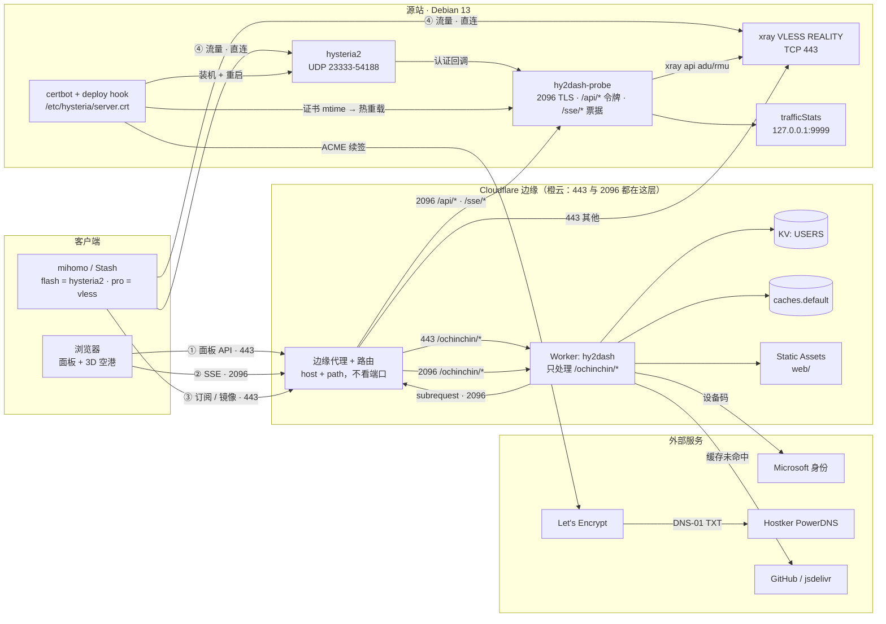
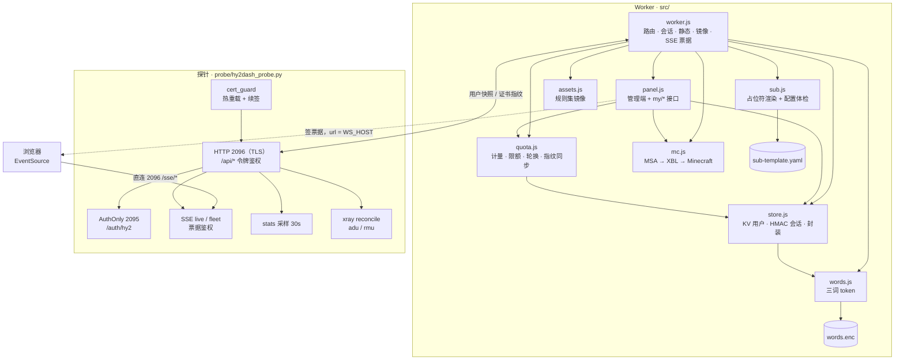

# hy2dash

Cloudflare Worker 版订阅与面板服务。**主分支已全面 serverless 化**：Go 单体已完整备份到
`archive/steam-host` 分支；原本单体里的流量采集被**拆成独立的源站后端** `probe/`
（纯标准库 Python + systemd，跑在 Hysteria 2 源站，详见 `probe/README.md`）。
主分支现在由「边缘 Worker + 静态资源 + 订阅模板 + 源站采集模块」四部分组成，
两侧只通过一组 `/api/*` JSON 契约耦合。

UI 与 3D 空港（`web/` 下除 `login.html` 以外的全部文件）保持字节不变，没有构建步骤、
没有 Node 工具链依赖，直接由 Workers Static Assets 托管。

## 登录：Microsoft 设备码 → Minecraft 正版

用户点登录按钮后走完整链路：

1. 微软设备码申请（`consumers` 租户，公共客户端，不带 client_secret）；
2. 用户在验证页输入代码；Worker 轮询 MSA token；
3. MSA token → Xbox Live user token → XSTS token；
4. XSTS → Minecraft 的 `login_with_xbox` → Minecraft access token；
5. `/minecraft/profile` 拿到正版 UUID 与游戏 ID，作为全局唯一身份。

Microsoft client_id 内置在 `src/mc.js` 的 `MS_CLIENT_ID` 常量里（当前是 Axolotl 启动器的
公共客户端 AppID）。它是公开的 OAuth 应用标识、不带 client_secret，因此不需要注入 Secret；
生产环境另设 `MS_CLIENT_ID` Secret 作为不改代码即可切换的覆盖入口。

**AppID 允许名单**：Mojang 自 2023 年起对 `login_with_xbox` 实行名单制，未过审的 Azure
应用返回 `403 Invalid app registration`，且前四步都成功、只有第 5 步被拒。2026-11-15
实测：最初内置的 SJMCL AppID 在此列；换成 Axolotl AppID 后本机直连六步全部 200，
**AppID 本身已不是障碍**。

**出站方式：6 个认证请求由源站探针代发，不从 Worker 直发。** `src/mc.js` 把每次调用
打包成 `{op, headers, body}`，POST 到 `ORIGIN_API_BASE + /api/relay/mc`；
`probe/hy2dash_probe.py` 用固定映射表（`RELAY_OPS`，仅 6 项）把 op 还原成微软/Mojang 的
官方 URL 并由源站出口发出，再把状态码与响应体原样回传。**端点不接受调用方提供的任意
URL**，因此不是开放代理；它复用探针的双层访问控制，不保管密钥、不落盘任何 token。
UI、会话、KV、订阅仍留在 Worker。

这么做的原因：Cloudflare Workers 的出站 IP 被 `api.minecraftservices.com` 前面的
Cloudflare WAF 拦截（2026-11-15 生产实测 `403 text/html`，响应头 `server: cloudflare` +
`cf-ray`，body 是 HTML 拦截页而非 JSON）；连不带 token 的 `GET /minecraft/profile`
基线也一样。同一请求从家宽 IP 或源站直连返回正常的 `401 {"error":"UNAUTHORIZED"}`。
若认证请求留在 Worker 里，第 5 步会失败且官方 JSON 错误原文为空，页面只显示 `HTTP 403`。
**这与 AppID、账号、正版资格、User-Agent 都无关**（UA 已做对照排除）。

代价与边界：登录依赖源站在线；平台边缘终止 TLS 后明文回源，MSA / XSTS / Minecraft
token 会经过 CF → 源站这一段；源站必须保持「回源 IP 段 + `CF-Worker` 精确值」双层校验，
否则代发端点可能被滥用。`ORIGIN_API_BASE` 因此是设备码登录的必需配置，不只是流量数据回源。

风险与后续：当前 AppID 仍是借用第三方启动器的过渡值，官方明确不鼓励且随时可能吊销；
长期应自己注册 Azure 应用（Personal Microsoft accounts only + 允许公共客户端流），
把 client_id 通过 `aka.ms/mce-reviewappid` 提交审核。口令登录已下线，管理权限由带
`admin: true` 标记的 MC 账号（当前 `bemly_`）获得，没有第二套密码入口。

以后换 AppID 有两种方式，其它代码都不用动：

- 改 `src/mc.js` 里那一行常量后提交（脱敏脚本的 GUID 白名单会自动跟着它走）；
- 或注入 Worker Secret / `.dev.vars` 的 `MS_CLIENT_ID`，它优先于内置值，可不改代码临时切换。

> 仓库里唯一允许出现的 GUID 就是这个内置 client_id；脱敏脚本按文件放行，
> 订阅节点 UUID、租户 ID 等其它 GUID 仍一律拦截。

## 缓存：免二次登录

- `hy2dash_session`：HttpOnly 签名会话 cookie，30 天；
- `hy2dash_id`：180 天识别 cookie。会话过期时自动重签，用户无需重新输码；
- KV 用户档案 + AES-GCM 加密的 refresh_token。超过 7 天后台刷新档案与令牌；
  **刷新失败会写控制台并让后台任务失败，不静默吞掉**（登录态本身不受影响，但故障必须可见）。
  解密失败视为数据损坏并抛错，不伪装成「没有 token」。

会话签名与 refresh_token 加密的密钥都由 `SESSION_SECRET` 派生。

## 订阅

`GET /<word-word-word>` 返回 YAML。模板 `sub-template.yaml` 以当前线上 yml 为准：

- 566 条 `rules` 逐行原样保留；
- 一行式节点 / 分组 / provider / rule-provider 配置保持单行，**不拆成块状 YAML**；
- 动态部分只有 13 个标量 `__XXX__` 占位符（Worker vars + secrets）和一个派生的
  `__SERVER_DIRECT_RULES__`（节点自身直连规则），渲染时仅做字符串替换，不解析、不重排 YAML；
- 配置缺失、格式非法或占位符残留时返回 503 并指名具体字段；`/api/health` 的 `sub_config`
  字段报告同一套检查结果。

订阅链接是 **3 个好记的词直连**（可重复、有序），来自 `words.enc`（4736 行词表的
ROT47 入库，解码后 4716 个有效词）。词本身可含连字符，所以 `src/words.js` 用 DP
把 token 切成恰好 3 个词表词。词表有效词不足 64 个时**模块加载即抛错、拒绝启动**，
没有 hex 之类的降级格式；旧 32 位 hex 链接也不再兼容。管理员可在面板换链，
换链后旧链接立即失效。

不返回 `Subscription-Userinfo`：没有计量执行点，不伪造 `upload=0; download=0`。

## 架构

### 全景：部署拓扑与四条主链路



1. **面板**：浏览器 → 边缘（443，`/ochinchin/*`）→ Worker（会话 cookie）→ 边缘（subrequest 到 2096）
   → 探针（`X-Probe-Token`）。SSE 只是 Worker **签发**票据，浏览器随后自己连
   `https://www.bemly.moe:2096/sse/live`，由探针直接推流——这条路上没有 Worker。
2. **订阅**：`GET /ochinchin/<三词>`；token 定位用户，YAML 由 `sub-template.yaml` 渲染。
   同一条路由也给客户端提供规则集 / geo 镜像。
3. **流量**：客户端直连源站 IP 上的 hysteria2 / xray，这一条路上没有 Cloudflare、没有 Worker、没有 KV。
4. **证书**：certbot（DNS-01 走 Hostker PowerDNS）→ deploy hook 覆盖 `/etc/hysteria` →
   hysteria 重启、探针热重载自己的 TLS、Worker cron 把新指纹写进 KV。

**请求计费口径（已在生产验证）**：Workers 路由只匹配 host + path，不看端口——
`https://www.bemly.moe:2096/ochinchin/api/health` 返回的是 Worker 的 JSON，而 `:2096/api/*`、
`:2096/sse/*` 落到探针。所以 2096 的流量**只有 `/ochinchin/*` 路径**算 Worker 请求；SSE 与探针 API
都不会触发 Worker。但 SSE 仍然穿 Cloudflare 边缘：2096 上出示的是边缘证书（Google Trust Services WE1），
不是源站那张。

### 模块耦合：谁调用谁、谁拥有哪份状态



- `store.js` 是唯一碰 KV 的模块（`u:` 用户、`t:` token → uuid、`d:` 设备码、`cfg:seq`、
  `cfg:cert_fp`），其他模块只调它导出的函数。
- `quota.js` 独占「往源站写」的方向：`pushUsers()` 推用户快照、`syncCertFp()` 写指纹、
  `enforceQuotas()` 轮换凭证。
- `sub.js` 不解析 YAML，只做 `__PLACEHOLDER__` 替换，并且拒绝下发残留占位符。
- `panel.js` 只是票据签发方，不是代理：SSE 的帧由探针直推浏览器。
- Worker 与探针没有共享存储，唯一契约是 HTTP + `X-Probe-Token`。

## 部署

```sh
npm i -D wrangler                       # 或全局安装
wrangler login
wrangler kv namespace create USERS      # 把返回的 namespace id 填进 wrangler.toml
cp .dev.vars.example .dev.vars          # 本地开发用；填真实值
wrangler secret put SESSION_SECRET      # 生产逐个注入，见下方清单
wrangler deploy
```

`wrangler.toml` 里的 `REPLACE_WITH_KV_NAMESPACE_ID` 必须替换。部署后在平台控制台把自定义域
绑定到该 Worker；`run_worker_first=true` 已开启，所有请求（含 `/`）都会先经过 Worker 做登录检查。

### 必填 Secrets

| 名称 | 用途 |
| --- | --- |
| `SESSION_SECRET` | 会话 HMAC 签名 + refresh_token 加密 |
| `HY2_SERVER` / `HY2_FINGERPRINT` | Hysteria 2 节点参数（fingerprint 即证书 pin） |
| `REALITY_SERVER` / `REALITY_PUBLIC_KEY` | VLESS REALITY 节点参数 |
| `EDGETUNNEL_URL` | 第三方 provider 地址 |
| `ORIGIN_API_BASE` | 橙云 proxied 回源域名（不带端口）：认证代发 + 流量数据回源共用；设备码登录必需 |
| `PROBE_TOKEN` | 回源共享令牌，每个回源请求带 `X-Probe-Token`，源站同名校验 |

节点**凭证按用户发**：`HY2_PASSWORD` / `REALITY_UUID` 不再作为全局 Secret，而是每个用户记录里的
`hy2_pass` / `vless_uuid`，订阅渲染时填入模板（超限封禁时会整体轮换）。

可选：`MS_CLIENT_ID`（覆盖内置的 client_id）、`BASE_PATH`（子路径部署）、`SUB_TOTAL_BYTES`。

**平台账号凭据（全局密钥、API Token、邮箱）绝不写进任何文件**，只用于本机 wrangler 登录态；
`.dev.vars` 已被 `.gitignore` 排除。提交前务必跑两次扫描：

```sh
./scripts/scan-secrets.sh
git add -A
./scripts/scan-secrets.sh --staged
```

## 数据回源（无降级）

Worker 本身不采集服务器流量；采集由仓库内的 `probe/` 模块在源站完成：
读取 Hysteria 2 `trafficStats`，维护活跃连接与按日 JSONL 历史，对外提供
`/api/live`、`/api/summary`、`/api/history`、`/api/overview`。
`src/panel.js` 的 `originJson()` 校验并透传这些 JSON。

链路是「Worker 子请求 → 橙云 proxied 域名（URL 不带端口）→ Origin Rule 改写回源端口
→ `probe` 的 2096」。鉴权是「回源 IP 段白名单 + 显式共享令牌 `X-Probe-Token`」两条同时满足，
令牌由 Worker 自己加进请求头，值来自 Secret `PROBE_TOKEN`，源站用常量时间比较。

不用 `CF-Worker` / `CF-Ray` 做门禁：Cloudflare 只在经边缘转发的子请求上注入这两个头，
**Cron Trigger 发起的子请求不一定带**，带的时候其值是 `<script>.<subdomain>.workers.dev`
而不是自定义域——拿它做严格比对会让定时任务永远 403。它们只进日志当旁证。

**失败即错误，不放假数据**：未配置 `ORIGIN_API_BASE` → 503；不可达 / 上游非 2xx /
非 JSON → 502 并带原因。管理端 `/api/live`、`/api/summary`、`/api/history`、`/api/overview`
一律回源探针；实时明细与 3D 空港走 SSE（`/sse/live`、`/sse/fleet`），数据流不经 Worker。
`day_used` 这类按日计量没有执行点，直接不返回该字段。

**用户维度**：`/api/my/summary`（当月上行/下行/已用/限额/百分比）与 `/api/my/live`
（只返回本人连接——探针 `/api/live?uid=` 在源站过滤，别人的目标地址不会离开源站）返回真实数据。
`/api/my/domains` 仍返回 501：探针历史只留目标地址字符串，没有做域名归并，
用户可直接在「历史记录」页签按域名搜索。
`/api/my/renew`、`/api/base_path`、`/api/restart`、`/api/hostker/refresh` **已删除**：
配额按自然月重置、没有「续额」动作，serverless 无法运行时改基础路径或重启，也未接入 DNS 服务商。
绝不返回 `{ok:true}` 或结构完整的空数据冒充成功。

**月限额，无日限额**：配额只按自然月计，默认 100G（`monthly_gb`），不设日限额。
管理账号（用户记录 `admin: true`，当前是 `bemly_`）与 `monthly_gb <= 0` 都视为**不限**；
`/api/user/quota` 只接受 `monthly_gb`（0 = 不限），拒绝给管理账号设置限额。

**超限是吊销，不是踢线**：Cron 每分钟（`src/quota.js`）拿探针的当月计量判定，超限即写
`blocked_month` 并轮换该用户的 `hy2_pass` / `vless_uuid`，源站收到快照后 `/kick` 断线、
`xray rmu` 删掉该 UUID、`/auth/hy2` 对 blocked 一律 `ok:false`——旧订阅里的所有节点同时失效，
重连只会超时。订阅链接本身返回 **403**，月初自动解封并再换一套凭证，用户需重新拉订阅。
判定只采信探针返回的**当月**计量，避免月初源站尚未翻页时把刚解封的用户又封一遍。
Xray SSH 同步、Hostker 统计等 Go 时代能力不在两侧重实现，完整代码保留在 `archive/steam-host`
分支。探针的部署、接口契约与访问控制见 `probe/README.md`。

## 证书续签（DNS-01，Hostker PowerDNS）

源站 443 是 xray REALITY、80 也没留给 HTTP-01，所以只能走 DNS-01：ACME 客户端往 Hostker 的
PowerDNS 写 `_acme-challenge` TXT 记录完成验证（[Hostker 文档](https://docs.hostker.net/https/renew/)）。

**分两层，不重复**：

| 层 | 谁做 | 做什么 |
|---|---|---|
| 冷启动 | `probe/setup_cert.py`（Python，跑一次） | 写 `/etc/letsencrypt/powerdns.ini`、装 deploy hook、执行 `certbot certonly --authenticator dns-powerdns` |
| 运行期 | 探针的 `cert_guard` 线程 | 每 6 小时看剩余天数，低于 `CERT_RENEW_DAYS`（默认 30）就执行 `CERT_RENEW_CMD`（默认 `certbot renew --quiet`）；证书文件一变就**热重载**监听上下文 |

- 装包：Debian 13 官方源**自带 certbot**（`apt install certbot`，4.0.0-2+deb13u1，trixie/main），
  但**没有** PowerDNS 认证插件。`certbot-dns-powerdns` 是第三方包，只能 pip 装，且不能带依赖装：
  它把 `dns-lexicon<=3.5.6`、`pyyaml<6`、`cryptography<4` 写死，PyYAML 5.x 在 Python 3.13 上编译不过。
  实测可用的组合：
  ```sh
  apt install certbot python3-pip python3-zope.interface
  pip install --break-system-packages --no-deps certbot-dns-powerdns
  pip install --break-system-packages dns-lexicon
  ```
  （`zope.interface` 是插件要的，而 Debian 的 certbot 4 自己已经不再依赖它。）
- deploy hook `/etc/letsencrypt/renewal-hooks/deploy/hy2dash-cert.sh`：把新的 `fullchain.pem` /
  `privkey.pem` 复制到 `/etc/hysteria/server.{crt,key}` 并重启 `hysteria-server`。
- **`certbot.timer` 是有意停用的**（和之前停用 acme.sh 的 cron 同理）：探针是唯一调度者，
  “什么时候续”只有一个地方决定。
- 凭据：`~/.config/hy2dash/cert.env`（0600，字段见 `probe/cert.env.example`），不入库。
- **不需要重启探针**：`cert_guard` 发现 `server.crt` 的 mtime 变了就重建 `SSLContext`，只影响新连接，
  正在跑的 SSE 不受影响；所以 `reloadcmd` 只重启 `hysteria-server`。
- **指纹不需要人工维护**：探针 `/api/cert` 返回当前证书的 SHA-256 与到期时间，Worker 的 cron 每分钟取一次，
  **只在指纹真的变化时**写 KV `cfg:cert_fp`（KV 免费额度 1000 写/天，每分钟无条件写会直接超）。
  订阅渲染以 KV 为准，同一个值填两个字段：`fingerprint`（mihomo 的证书 pin）与
  `server-cert-fingerprint`（Stash 的字段）——模板里 `__HY2_FINGERPRINT__` 出现两次，不再保留第二个变量。
  secret `HY2_FINGERPRINT` 只是首次部署的引导值。续签后 ≤60 秒，客户端拉订阅即拿到新指纹。

## 目录

```
src/worker.js       路由、会话、静态资源、设备码端点
src/mc.js           Microsoft / Xbox / Minecraft 登录链路
src/store.js        KV 用户存储、签名与加密、cookie
src/panel.js        面板 API（保持旧前端契约）
src/sub.js          订阅模板渲染
probe/              源站数据采集后端（Python + systemd，从 Go collector 拆出）
web/                UI + 3D 资源（原样）
sub-template.yaml   订阅模板（当前线上 yml，脱敏）
scripts/scan-secrets.sh  提交前明文扫描
probe/setup_cert.py     首次签发证书（DNS-01 via Hostker PowerDNS）
probe/cert.env.example  证书签发凭据模板（真实文件在 ~/.config/hy2dash/cert.env）
```
